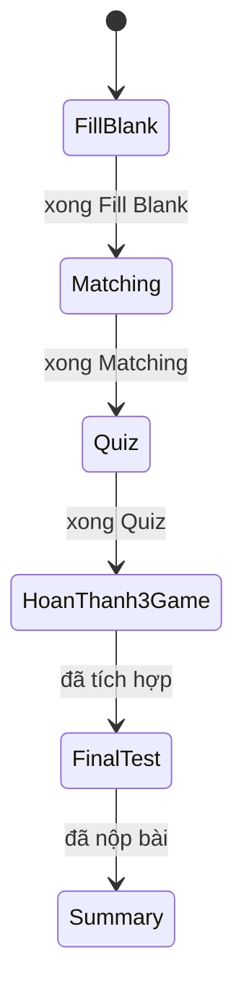

# Edu_game: Web ôn bài bằng các trò chơi

**Mục tiêu hoàn chỉnh (thiết kế):** người học tải Word/PDF → trích văn bản → AI sinh câu hỏi (`chapter.json`) → ba game theo thứ tự cố định → bài kiểm tra cuối → tổng kết và ôn câu sai.

**Bản demo Final Test:** Quiz lấy câu từ cả ba game trong cùng chương (tối đa 30), dùng 2–4 lựa chọn và tính điểm thang 10 theo `10 × score / total`. Logic, API, giao diện và tổng kết đã được tích hợp; đặc tả nằm ở `docs/02-kiem-thu-final-test.md`.

**Phiên bản hiện có:** server HTML chạy **Fill Blank (chọn đáp án điền chỗ trống) → Matching → Quiz → Final Test → Tổng kết** với dữ liệu JSON mẫu hoặc JSON do API nhận. Phần tải file và sinh câu hỏi AI chưa tích hợp vào luồng demo.


---

## 1. Dự án làm gì

| Mục | Nội dung |
|---|---|
| Đối tượng | Người muốn ôn bài |
| Mục tiêu | Biến tài liệu (Word/PDF) thành các trò chơi để ôn bài bớt khô khan |
| Phần của em | Phần **game**: từ lúc có `chapter.json` đến lúc hiện kết quả (3 game, server dẫn thứ tự, giao diện HTML) |
| Phần của bạn khác | Tiền xử lý (`preprocess.py`), AI sinh câu hỏi (`ai_generate.py`, `prompts.py`), bài kiểm tra cuối (`final_test.py`), tổng kết (`summary.py`, `app.py`) |

Tính năng: F1 tải file · F2 điền chỗ trống (chọn đáp án tự sinh từ dữ liệu) · F3 nối từ · F4 trắc nghiệm · F5 bài kiểm tra cuối · F6 xem điểm · F7 ôn lại câu sai.

## 2. Cách chạy

```bash
pip install -r requirements.txt     # thư viện của cả nhóm (Streamlit, Pydantic, ...)
python server.py                # phần game chỉ cần thư viện chuẩn, mở http://127.0.0.1:8000
python -m unittest discover -s tests -v  # chạy test luồng game
```

Khóa API (cho module AI của bạn khác): copy `.env.example` thành `.env` và điền `ANTHROPIC_API_KEY`. File `.env` đã nằm trong `.gitignore`, không commit.

---

## 3. Em dùng gì để phân tích hệ thống

Trước khi viết code, em đọc 3 lớp tài liệu, đều nằm trong `docs/` và lưu bằng **text** để đưa vào Git:

**a) Kịch bản và planning (`docs/01-kich-ban.md`)**
Mô tả theo thứ tự: tổng quan → danh sách tính năng (F1–F7) → quan hệ giữa các thành phần → luồng xử lý từng bước (ghi rõ *ai làm gì*) → API giữa các phần → quy tắc dữ liệu và chấm điểm → giai đoạn → quyết định đã chốt / còn mở. Điểm em thấy hữu ích nhất là mục **"Quyết định còn mở"**: chỗ nào nhóm chưa thống nhất thì ghi **[Cần chốt]** thay vì tự đoán (ví dụ điểm các game thành phần 5 điểm cố định hay theo tỷ lệ; bài kiểm tra cuối được định hướng tối đa 30 câu, thang 10).

**b) UML viết bằng text (`docs/01-UML-phan-game.md`)**
Mỗi loại sơ đồ trả lời một câu hỏi khác nhau:

| Câu hỏi cần trả lời | Sơ đồ | Công cụ |
|---|---|---|
| Ai dùng hệ thống, làm được gì? | Use case (kèm đặc tả use case) | PlantUML (và bản Mermaid `flowchart` để GitHub tự vẽ) |
| Có class/hàm nào, liên hệ ra sao? | Class diagram | Mermaid `classDiagram` |
| Một thao tác đi qua hàm nào, theo thứ tự nào? | Sequence diagram | Mermaid `sequenceDiagram` |
| Hệ thống có những trạng thái nào? | State diagram (trạng thái mở khóa game) | Mermaid `stateDiagram-v2` |
| Các thành phần dữ liệu liên quan nhau thế nào? | ERD: Chương → Phần → Game → Câu hỏi | Mermaid `erDiagram` |

Quy trình 6 bước em dùng: thu thập thông tin từ planning → chọn loại sơ đồ → viết text → dán vào mermaid.live → chỉnh cho khớp code → lưu vào `docs/` và commit. Lý do chọn UML dạng text: Agent đọc text chính xác hơn đọc ảnh, xem được `git diff` khi sơ đồ đổi, sửa một dòng là sơ đồ đổi.

**c) Hợp đồng dữ liệu**
Trước khi viết game, em chốt hai "hợp đồng" mà mọi thành viên phải theo (chi tiết ở mục 4): cấu trúc `chapter.json` và kết quả `{score, total, wrong}`. Nhờ vậy game không cần biết AI sinh câu hỏi thế nào, và module AI không cần biết game chấm thế nào.

State diagram của luồng demo hiện tại (thứ tự cố định):



---

## 4. Em định nghĩa các file như thế nào

```
Edu_game/
├── CLAUDE.md             Luật làm việc với Agent: phạm vi, quy ước, điều cấm
├── .claude/skills/       3 skill: Coding, Testing, Documentation
├── server.py             Server http.server: dẫn thứ tự 3 game, mở khóa, nhận API (em)
├── web/
│   ├── fill_blank.html   Giao diện game 1                                          (em)
│   ├── matching.html     Giao diện game 2 + nút "Tiếp tục"                         (em)
│   ├── quiz.html         Giao diện game 3                                          (em)
│   └── final_test.html   Giao diện bài kiểm tra cuối
│   └── final_test.html   Giao diện bài kiểm tra cuối
├── games/                LOGIC game, Python thuần, không phụ thuộc giao diện
│   ├── fill_blank.py     Game 1: điền chỗ trống                                    (em)
│   ├── matching.py       Game 2: nối từ                                            (em)
│   ├── quiz.py           Game 3: trắc nghiệm
│   └── final_test.py     Dựng câu hỏi bài kiểm tra cuối
├── data/                 6 file JSON mẫu = 2 môn (english, philosophy) × 3 game
├── tests/                test_game_flow.py và test_final_test.py
├── docs/                 Kịch bản, UML, việc cần làm
├── preprocess.py         Đọc PDF/Word → văn bản sạch (Toàn)
├── ai_generate.py        Gọi AI → chapter.json, kiểm tra bằng Pydantic (Sang)
├── prompts.py            Prompt từng môn, từng phần (Sang)
├── summary.py, app.py    Màn hình Streamlit của luồng khác/chưa tích hợp
├── .env.example          Mẫu khóa API (không chứa khóa thật)
└── .gitignore            Chặn .env, __pycache__, cache/, uploads/
```

### Nguyên tắc thiết kế (nằm trong `CLAUDE.md`)

1. **Tách logic và giao diện.** `games/` không import `http.server` hay Streamlit; `server.py` và `web/` chỉ gọi logic.
2. **Game chỉ đọc dữ liệu theo hợp đồng**, không đọc văn bản thô, không gọi API AI.
3. **Đáp án đúng ở lại phía server.** `public_view()` chỉ gửi câu và những phương án có `idx` (không đánh dấu đáp án đúng); `check_one()` mới trả `correct_idx`/`correct_text` sau khi kiểm tra. Fill Blank hiện **chọn đáp án**, không gõ văn bản.
4. **Mọi game cùng một khuôn class:** `__init__(items)` gọi `validate_items` (lỗi thì `raise ValueError` bằng tiếng Việt) → `public_view()` → hàm chấm (`check` / `check_one`) → `result()`.
5. **Thứ tự game hiện là cố định trong `server.py`**, mở khóa dựa trên các cờ `FLOW_STATE`, không có biến `GAME_ORDER`/class `GameFlow` trong code. Danh sách cấu hình và random thứ tự là **thiết kế tương lai**, chưa triển khai.
6. **Hạn chế hiện tại:** `FLOW_STATE` chung cho mọi kết nối và chưa khóa môn/chương xuyên suốt phiên chơi; không coi demo hiện tại là hệ thống đa người dùng.

### Hợp đồng `chapter.json`

```json
{"subject": "english|philosophy", "chapter_title": "...",
 "parts": [
  {"part": 1, "game": "fill_blank", "items": [{"id": "p1-01", "sentence": "... ___ ...", "answer": "..."}]},
  {"part": 2, "game": "matching",   "items": [{"id": "p2-01", "term": "...", "definition": "..."}]},
  {"part": 3, "game": "quiz",       "items": [{"id": "p3-01", "q": "...", "options": ["","","",""], "answer": 0}]}
 ]}
```

**Hợp đồng dự kiến cho `chapter.json` đầy đủ:** đúng 3 phần theo thứ tự 1, 2, 3; `fill_blank` có đúng **một** `___`, đáp án không rỗng và có ít nhất hai đáp án phân biệt để sinh lựa chọn; `quiz` có 4 options và `answer` là 0..3; `id` không rỗng và không trùng trong cùng phần. **File JSON mẫu hiện chỉ chứa một phần** (một game mỗi file).

**Cách Fill Blank hoạt động hiện nay:** đối với mỗi chỗ trống, game lấy đáp án đúng và tối đa ba đáp án nhiễu từ câu khác trong cùng bộ, xáo trộn và hiển thị 2–4 lựa chọn. Người học nhấn chọn, trình duyệt gửi `qid` và `idx` để server chấm. Fill Blank khác Quiz ở chỗ các lựa chọn không phải nhập sẵn vào JSON từng câu.

### Hợp đồng kết quả

```json
{"score": 7, "total": 8, "wrong": ["p1-03"], "review": [...]}
```

`score` là **số câu đúng**, không phải điểm thang 100. Các game thành phần vẫn hiển thị `score/total`; điểm theo quy tắc 5 điểm/câu hay chuẩn hóa vẫn **[Cần chốt]**. Final Test tính điểm thang 10 theo `10 × score / total` (không làm tròn trong logic), và trang tổng kết hiển thị hai chữ số thập phân. `review` là phần thêm cho giao diện.

### API giữa giao diện và server

| Route | Việc |
|---|---|
| `GET /` | Chuyển tới bước đang mở; sau Final Test hiển thị tổng kết |
| `GET /matching.html` | Bị chuyển về `/` nếu game 1 chưa xong |
| `GET /quiz.html` | Bị chuyển về `/` nếu game 2 chưa xong |
| `GET /final_test.html` | Bị chuyển về `/` nếu chưa hoàn tất Quiz |
| `GET /api/fill_blank/files`, `/api/matching/files`, `/api/quiz/files` | Liệt kê file mẫu theo game |
| `POST /api/fill_blank/new` · `/check` · `/result` | Tạo ván, chấm từng câu, lấy kết quả; hoàn thành mới mở khóa game 2 |
| `POST /api/matching/new` · `/check` | Tạo ván, chấm cả ván; hoàn thành mới mở khóa game 3 |
| `POST /api/quiz/new` · `/check` · `/result` | Tạo ván, chấm từng câu, lấy kết quả; chỉ mở sau game 2 |
| `POST /api/final_test/new` · `/check` · `/result` | Tạo bài thi từ cùng chương, chấm đáp án và trả điểm thang 10 |

---

## 5. Em viết code như thế nào: chỗ nào tự viết, chỗ nào nhờ AI

### Quy trình làm việc

```
Em đặt yêu cầu nhỏ + tiêu chí hoàn thành (docs/viec-can-lam.md)
        ↓
Agent liệt kê file định sửa → em duyệt
        ↓
Agent sửa code + viết test
        ↓
Em chạy test, chạy thử bằng tay, đọc git diff
        ↓
Commit nhỏ trên branch riêng (theanh-branch) → pull request
```

Ví dụ thật trong repo: `docs/viec-can-lam.md` có hai lần giao việc, mỗi lần một vấn đề + yêu cầu + cách test.
- *Lần 1:* sửa `server.py` để chơi theo thứ tự (không vào được game 2 khi chưa xong game 1; bỏ màn hình chọn game).
- *Lần 2:* UI không chuyển được sang game kế tiếp sau fill_blank → thêm nút "Tiếp tục" cho `fill_blank.html` và `matching.html`.

Hai lần này tương ứng với commit `983c93b "Sửa lại để đảm bảo chuyển game hoạt động"` (sửa `server.py`, hai file HTML, thêm `tests/test_game_flow.py`).

### Phân chia tự viết / nhờ AI

> **✏️ Em kiểm tra lại cột "Thực tế".** Repo cho thấy *cách em tổ chức việc nhờ AI*, nhưng không cho thấy từng dòng code là của ai. Em điền đúng sự thật; giảng viên hỏi thì em trả lời được.

| Phần | Em làm | Nhờ AI | Thực tế (em điền) |
|---|---|---|---|
| Phân tích, kế hoạch, chốt quyết định (`docs/01-kich-ban.md`) | Quyết định nội dung, danh sách [Cần chốt] | Soạn, trình bày bảng | ☐ |
| UML Mermaid/PlantUML | Đối chiếu tên hàm với code, dán mermaid.live kiểm tra | Viết text sơ đồ | ☐ |
| Khuôn class game, hợp đồng dữ liệu | Thiết kế khuôn, đặt ràng buộc | Viết code theo khuôn | ☐ |
| `games/matching.py`, `games/fill_blank.py` | ? | ? | ☐ |
| `server.py` (khóa theo thứ tự, API) | Mô tả hành vi mong muốn | Viết code theo việc cần làm | ☐ |
| `web/*.html` | ? | ? | ☐ |
| `tests/test_game_flow.py` | Quyết định cần test gì | Viết test | ☐ |
| `CLAUDE.md` | Đặt luật, điều cấm | Soạn cho gọn | ☐ |

Cách em đặt ranh giới: **AI viết nhanh phần lặp theo khuôn (HTML/CSS, hàm chấm, test), còn quyết định kiến trúc, hợp đồng dữ liệu và quy tắc nghiệp vụ là của em**, vì AI không biết nhóm đã chốt gì.

---

## 6. Làm sao em kiểm soát code tốt hơn

**a) Giới hạn phạm vi cho Agent (`CLAUDE.md`)**
- Chỉ sửa phần game của mình; file của Toàn, Sang, Sơn Nguyễn, Sơn Phạm **không tự ý sửa**.
- Việc nhóm chưa chốt thì Agent phải **hỏi lại**, không đổi hành vi hiện có.
- Danh sách điều cấm: không đổi `chapter.json` hay `{score, total, wrong}`; không đưa đáp án vào `public_view()`; không thêm thư viện; không sửa test cho pass; không "tiện tay" sửa chỗ không liên quan; không đưa API key vào code.

**b) Việc nhỏ, tiêu chí rõ**
Mỗi lần chỉ một việc, kèm điều kiện hoàn thành ("không vào được game 2 khi chưa xong game 1"). Việc nhỏ thì diff nhỏ, đọc được.

**c) Kiểm tra dữ liệu ở biên**
Mỗi game có `validate_items` trả về danh sách lỗi tiếng Việt; constructor `raise ValueError` nếu dữ liệu sai. `check_one` / `check` từ chối chỉ số không hợp lệ (kể cả `bool`), từ chối chấm khi chưa ghép đủ cặp. `result()` từ chối khi chưa trả lời hết, và đó chính là điều kiện mở khóa game 2.

**d) Test**
`tests/test_game_flow.py` và `tests/test_final_test.py` kiểm tra luồng ba game, Final Test và hợp đồng kết quả; toàn bộ suite hiện có 34 test:
- Matching bị khóa cho đến khi fill_blank có kết quả đầy đủ.
- Fill_blank chưa trả lời hết thì không mở khóa matching.
- Quiz bị khóa cho đến khi Matching hoàn thành; hoàn tất Quiz mới mở Final Test.
- Luồng HTTP thật: khóa trang/API khi chưa hoàn tất bước trước; sau Final Test, trang chủ hiển thị tổng kết.
- Danh sách file Quiz, cấu trúc dữ liệu, subject và nút chuyển tiếp giữa các game được kiểm tra.

**e) Git**
Commit nhỏ, mỗi việc một commit, message nói rõ việc; làm trên branch riêng (`theanh-branch`) rồi gộp qua pull request; luôn đọc `git diff` trước khi commit. Commit `d4d41c5` còn cho thấy em dọn repo (bỏ `web/index.html`, dùng redirect từ server).

**f) Không tin AI mù quáng**
`docs/01-UML-phan-game.md` ghi rõ: sơ đồ chưa render thử thì phải dán vào mermaid.live, tên class/hàm do Agent viết có thể bịa nên phải đối chiếu với code thật. Trong code có `EnglishQuizGame` và hàm dựng đề `build_final_quiz`; `GameFlow`/`GAME_ORDER` chưa tồn tại.

---

## 7. Em đã biết thêm những công cụ nào để code ngày càng ổn hơn

**Đã dùng trong dự án (có dấu vết trong repo):**

| Công cụ | Dùng để |
|---|---|
| Git / GitHub: branch, commit nhỏ, pull request, `git diff` | Làm việc nhóm, kiểm soát thay đổi |
| `CLAUDE.md` (và `copilot-instructions.md` ở commit `53f0221`, sau đó đã gỡ) | Đưa luật và bối cảnh dự án cho Agent đọc |
| Mermaid, PlantUML, mermaid.live | UML dạng text, kiểm tra và xuất ảnh |
| `unittest` + `http.client` + `ThreadingHTTPServer` | Test luồng game, kể cả test HTTP thật |
| `.env`, `.env.example`, `.gitignore` | Giấu khóa API, không commit rác |
| `http.server` (thư viện chuẩn) | Server nhẹ, không cần cài thêm gì |
| Pydantic, python-dotenv | Kiểm tra JSON do AI sinh, đọc `.env` (có trong `requirements.txt`, module của bạn khác dùng) |

**Em đã biết và dự định áp dụng (chưa triển khai như một phần quy trình mặc định):**

| Công cụ | Giúp gì |
|---|---|
| `pytest` | Chưa phải lệnh test mặc định; hiện test dùng `unittest` và `requirements.txt` chưa khai báo pytest |
| `ruff` / `black` | Tự bắt lỗi và định dạng code |
| `pre-commit` | Chạy lint và test trước mỗi commit |
| GitHub Actions | Tự chạy test mỗi khi push hoặc mở pull request |
| `coverage` | Xem phần code nào chưa có test |

---
## 8. Điều em học được

- Viết **thiết kế và luật trước**, rồi mới để AI viết code: AI làm tốt khi có khuôn và hợp đồng rõ.
- AI hay "đoán" chỗ nhóm chưa chốt, nên ghi **[Cần chốt]** và cấm tự suy diễn.
- Code AI viết ra vẫn phải **đọc diff, chạy test, chạy thử bằng tay**; test là bằng chứng, không phải lời hứa.
- Tách logic khỏi giao diện giúp test được logic mà không cần mở trình duyệt, và giúp đổi giao diện (Streamlit ↔ HTML) mà không viết lại game.
