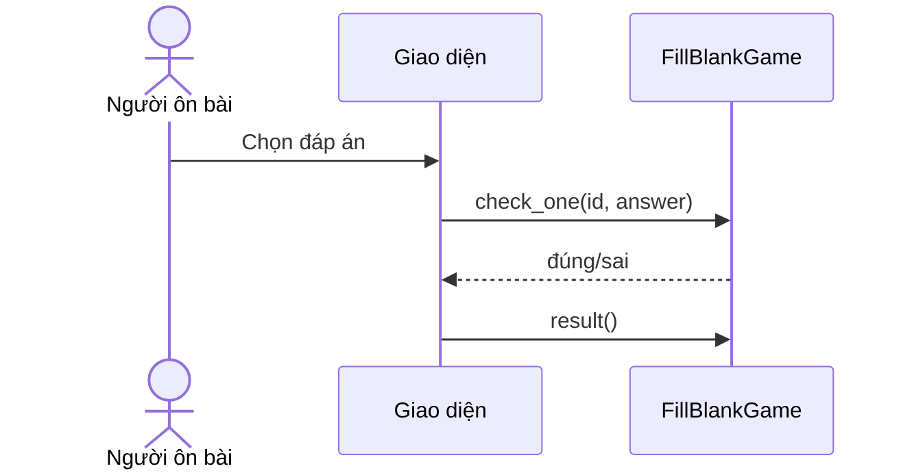
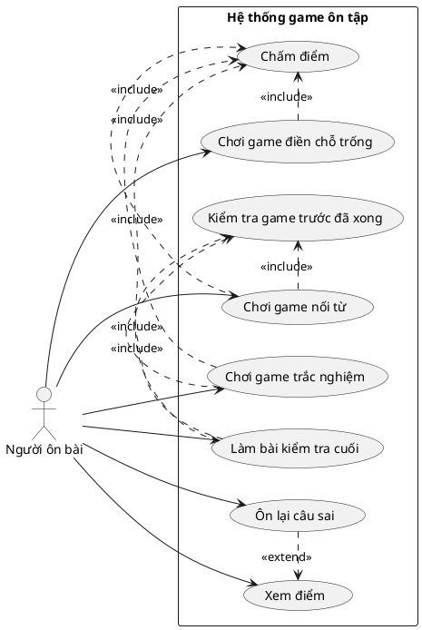
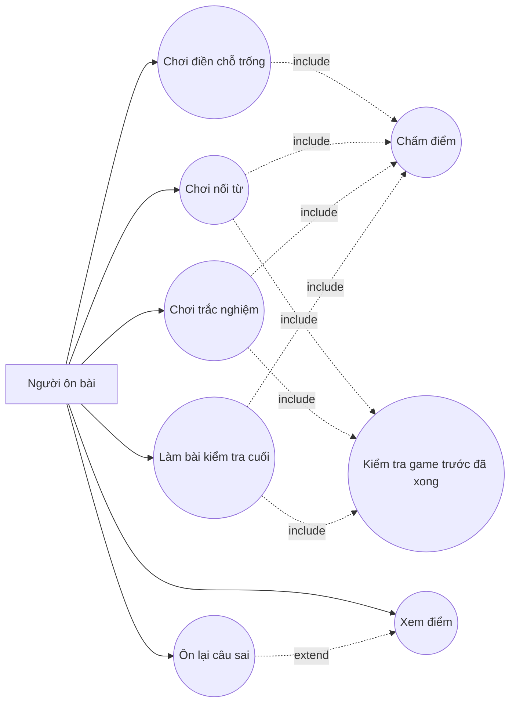
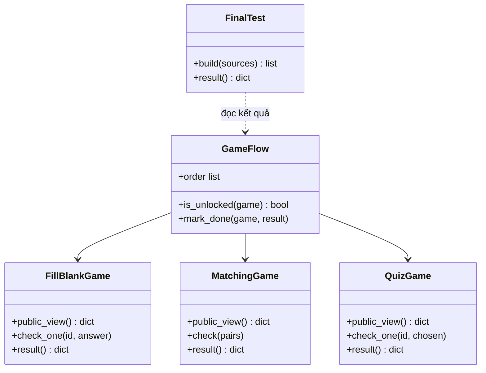
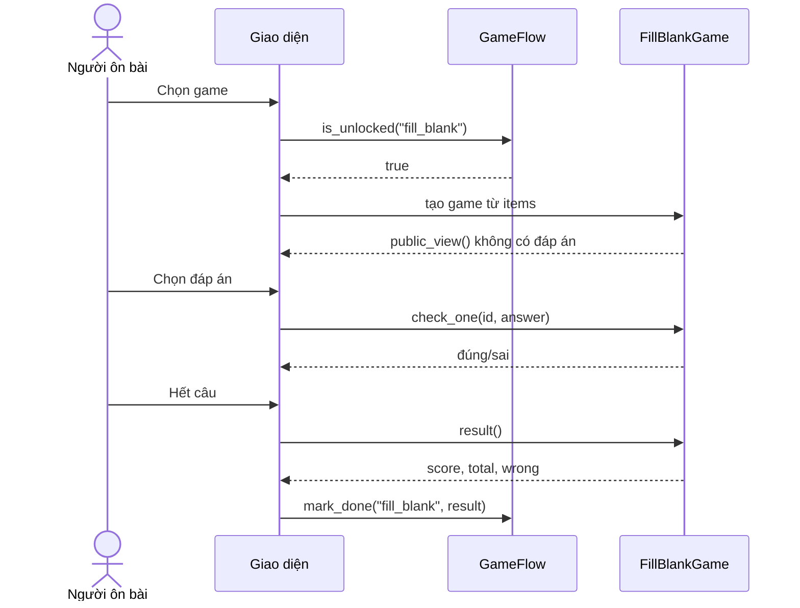
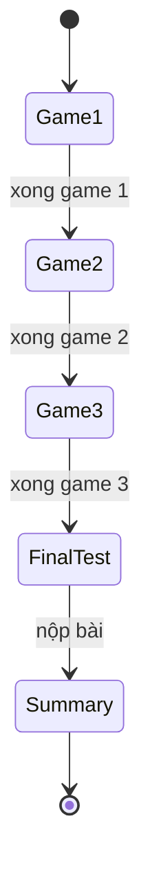

# UML phần game ôn tập (Edu_game)

Tài liệu này gồm 2 phần:
- **Phần A:** cách biến UML thành text rồi đưa vào Mermaid / PlantUML.
- **Phần B:** bộ 4 sơ đồ của phần game (use case, class, sequence, state) kèm đặc tả use case.

Đặt file này vào `docs/` trong repo. GitHub tự vẽ các khối ```` ```mermaid ```` khi mở file `.md`.

> Lưu ý trung thực: các sơ đồ dưới đây chưa được render thử trong lúc soạn. Hãy dán từng khối vào
> **mermaid.live** (Mermaid) hoặc **plantuml.com/plantuml** (PlantUML), kiểm tra, chụp ảnh làm bằng chứng.
> Các class `QuizGame`, `FinalTest`, `GameFlow` là **thiết kế dự kiến**, chưa chắc đã có trong code;
> tên và chữ ký hàm của `FillBlankGame`, `MatchingGame` cần đối chiếu lại với `games/fill_blank.py`, `games/matching.py`.

---

# PHẦN A. Biến UML thành text rồi đưa vào Mermaid

## A1. Ý tưởng

UML là sơ đồ (hình). "Viết UML bằng text" nghĩa là **mô tả sơ đồ bằng vài dòng chữ theo cú pháp riêng**,
rồi công cụ tự vẽ ra hình. Ba lý do nên làm vậy:

1. Agent (Copilot, Cursor, Claude) đọc text chính xác, còn ảnh thì phải đoán.
2. File text lưu được trong Git, xem được `git diff` khi sơ đồ thay đổi.
3. Sửa một dòng là sơ đồ đổi, không phải vẽ lại.

## A2. Quy trình 6 bước

```
(1) Thu thập thông tin  ->  (2) Chọn loại sơ đồ  ->  (3) Viết text
        |                                                 |
   từ Planning                                      (4) Dán vào công cụ xem
 (đối tượng, tính năng,                                   |
  quan hệ, API)                                    (5) Chỉnh cho đúng ý
                                                          |
                                                   (6) Lưu .mmd/.md + commit
```

| Bước | Việc làm | Ví dụ |
|---|---|---|
| 1 | Liệt kê thông tin cần vẽ | "Người chơi chọn đáp án, giao diện gọi `check_one`" |
| 2 | Chọn loại sơ đồ theo câu hỏi cần trả lời | Hỏi "hàm nào gọi hàm nào" -> sequence |
| 3 | Viết text theo cú pháp (bảng ở A3) | `UI->>G: check_one(id, answer)` |
| 4 | Dán vào mermaid.live | Thấy hình hiện ngay bên phải |
| 5 | Sửa lỗi cú pháp, đổi tên cho khớp code | So lại với tên hàm trong file `.py` |
| 6 | Lưu vào `docs/` và commit | `docs/04-sequence-choi-game.mmd` |

## A3. Chọn loại sơ đồ

| Câu hỏi cần trả lời | Loại UML | Công cụ |
|---|---|---|
| Ai dùng hệ thống, làm được gì? | Use case | **PlantUML** (Mermaid không có use case chuẩn) |
| Có class/hàm nào, liên hệ ra sao? | Class diagram | Mermaid `classDiagram` |
| Một thao tác đi qua hàm nào, theo thứ tự nào? | Sequence diagram | Mermaid `sequenceDiagram` |
| Hệ thống có những trạng thái nào, chuyển ra sao? | State diagram | Mermaid `stateDiagram-v2` |
| Các bảng dữ liệu liên quan nhau thế nào? | ERD | Mermaid `erDiagram` |

## A4. Bảng dịch "ký hiệu UML -> dòng text"

**Class diagram (Mermaid)**

| Ý muốn diễn đạt | Viết text |
|---|---|
| Khai báo class | `class QuizGame { }` |
| Hàm public | `+check_one(id, chosen)` |
| Thuộc tính | `+order list` |
| Hàm có kiểu trả về | `+result() dict` |
| Liên kết (A dùng B) | `A --> B` |
| Phụ thuộc (A chỉ đọc B) | `A ..> B : mô tả` |
| Kế thừa | `Cha <\|-- Con` |
| Gồm (thành phần) | `A *-- B` |

**Sequence diagram (Mermaid)**

| Ý muốn diễn đạt | Viết text |
|---|---|
| Người dùng | `actor P as Người ôn bài` |
| Thành phần hệ thống | `participant UI as Giao diện` |
| Gọi hàm | `UI->>G: check_one(id, answer)` |
| Trả kết quả | `G-->>UI: đúng/sai` |
| Tự gọi chính mình | `S->>S: so sánh` |

**State diagram (Mermaid)**

| Ý muốn diễn đạt | Viết text |
|---|---|
| Trạng thái đầu / cuối | `[*] --> Game1`, `Summary --> [*]` |
| Chuyển trạng thái | `Game1 --> Game2 : xong game 1` |

## A5. Ví dụ biến câu mô tả thành text

**Mô tả bằng lời:**
> Người chơi chọn đáp án. Giao diện gửi cho game. Game trả đúng hoặc sai. Hết câu thì giao diện hỏi kết quả.

**Chuyển từng câu thành một dòng:**

```
Người chơi chọn đáp án.            ->  P->>UI: Chọn đáp án
Giao diện gửi cho game.            ->  UI->>G: check_one(id, answer)
Game trả đúng hoặc sai.            ->  G-->>UI: đúng/sai
Hết câu thì giao diện hỏi kết quả. ->  UI->>G: result()
```

**Ghép lại thành sơ đồ hoàn chỉnh:**

````

````

Mẹo: mỗi câu mô tả chứa một "ai làm gì với ai" thì thành đúng một dòng.

## A6. Cách đưa vào Mermaid (3 cách)

| Cách | Làm thế nào | Dùng khi |
|---|---|---|
| **mermaid.live** | Mở https://mermaid.live, dán text vào ô bên trái, hình hiện bên phải. Bấm Actions để tải PNG/SVG | Kiểm tra nhanh, lấy ảnh dán vào báo cáo Word |
| **Trong file `.md` trên GitHub** | Bọc text trong khối ```` ```mermaid ```` ... ```` ``` ````; GitHub tự vẽ | Lưu tài liệu trong repo |
| **VS Code** | Cài extension hiển thị Mermaid trong Markdown Preview (tìm "Mermaid" trong Extensions), mở Preview | Viết và xem ngay trong editor |

Với file chỉ chứa sơ đồ, dùng đuôi `.mmd` và dán nội dung (không cần dòng ```` ```mermaid ````) vào mermaid.live.

**PlantUML (dùng cho use case):** dán code giữa `@startuml` và `@enduml` vào https://www.plantuml.com/plantuml,
hoặc dùng extension PlantUML trong VS Code. Lưu ý: Mermaid **không** vẽ được code PlantUML, hai công cụ riêng.

## A7. Dùng Agent để viết text, và những lỗi hay gặp

**Prompt mẫu:**
> Đây là mô tả luồng chơi game: [dán mô tả]. Hãy chuyển thành Mermaid `sequenceDiagram`, dùng đúng tên class/hàm
> trong `games/fill_blank.py`. Chỉ trả về code Mermaid, không giải thích.

Sau đó **bạn tự dán vào mermaid.live kiểm tra** và đối chiếu tên hàm với code thật; Agent có thể bịa tên hàm.

| Lỗi thường gặp | Cách sửa |
|---|---|
| Hình không hiện, báo lỗi cú pháp | Kiểm tra dòng đầu có đúng `classDiagram`, `sequenceDiagram`, `stateDiagram-v2` |
| Lỗi do ký tự đặc biệt trong nhãn | Bỏ hoặc đổi ký tự lạ; thử đặt nhãn trong dấu nháy kép |
| Tên có khoảng trắng | Dùng alias: `participant UI as Giao diện` |
| Sơ đồ khác code | Sửa tên cho đúng code, đừng để code chạy khác sơ đồ |

---

# PHẦN B. Bộ UML của phần game

## B1. Use case (PlantUML, ký hiệu chuẩn UML)



**Phiên bản Mermaid để GitHub tự vẽ** (chỉ tương đương về ý nghĩa, không phải ký hiệu UML chuẩn):



### Đặc tả use case "Chơi game điền chỗ trống"

| Mục | Nội dung |
|---|---|
| Tác nhân | Người ôn bài |
| Tiền điều kiện | `chapter.json` hợp lệ; game đứng trước (nếu có) đã xong |
| Luồng chính | 1. Hệ thống hiển thị câu có chỗ trống. 2. Người chơi chọn đáp án. 3. Hệ thống báo đúng/sai. 4. Hết câu thì hiện điểm. |
| Luồng thay thế | Dữ liệu sai cấu trúc: hiện lỗi thân thiện. Bấm kết thúc khi chưa trả lời hết: nhắc trả lời hết. |
| Hậu điều kiện | Kết quả `{score, total, wrong}` được lưu |

### Đặc tả use case "Làm bài kiểm tra cuối"

| Mục | Nội dung |
|---|---|
| Tác nhân | Người ôn bài |
| Tiền điều kiện | Đã hoàn thành cả 3 game |
| Luồng chính | 1. Hệ thống lấy câu hỏi từ 3 game theo tỷ lệ đã định. 2. Người chơi trả lời lần lượt. 3. Hệ thống chấm điểm. 4. Hiện tổng điểm và danh sách câu sai. |
| Luồng thay thế | Chưa xong game nào: nút bị khóa. |
| Hậu điều kiện | Điểm tổng kết được lưu để màn hình tổng kết đọc |

## B2. Class diagram (Mermaid)



## B3. Sequence diagram: chơi một game (Mermaid)



## B4. State diagram: trạng thái mở khóa (Mermaid)

Giai đoạn 1 (tuần tự cố định):



Giai đoạn 2 (random thứ tự 3 game): thứ tự ba trạng thái đầu lấy từ danh sách cấu hình `GAME_ORDER`
(ví dụ `random.shuffle`), phần còn lại giữ nguyên. Vì vậy mở khóa nên kiểm tra theo **vị trí trong danh sách**,
không kiểm tra theo số `part` trong JSON.

---

## Checklist trước khi nộp

- [ ] Mỗi khối Mermaid/PlantUML đã dán vào công cụ và hiển thị đúng
- [ ] Tên class và hàm trong sơ đồ khớp với code thật (hoặc ghi rõ "dự kiến")
- [ ] Đã chụp ảnh từng sơ đồ làm bằng chứng
- [ ] Các file lưu trong `docs/` và đã commit
- [ ] Báo cáo ghi rõ thứ tự game: giai đoạn 1 tuần tự, giai đoạn 2 random
