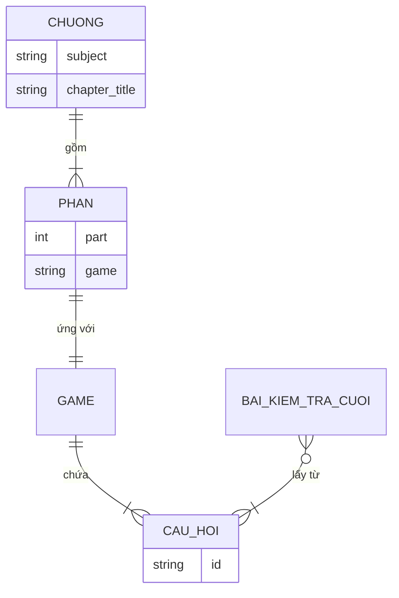

# 01. Kịch bản và Planning: Web ôn bài bằng các trò chơi

> File này là bản thiết kế chính thức của phần game, nằm trong `docs/`.
> Agent và các thành viên đọc file này trước khi code. Mọi thay đổi kế hoạch phải sửa file này và commit.
> Những chỗ ghi **[Cần chốt]** là điểm nhóm chưa thống nhất; chưa chốt thì không tự suy diễn.
> Danh sách việc cụ thể đang làm nằm ở `viec-can-lam.md`.

## 1. Tổng quan

| Mục | Nội dung |
|---|---|
| Tên dự án | Web ôn bài bằng các trò chơi |
| Đối tượng sử dụng | Người muốn ôn bài |
| Mục tiêu | Người học tải tài liệu lên, hệ thống biến thành các trò chơi ôn tập để việc ôn bài bớt khô khan |
| Phạm vi của tài liệu này | Phần game: từ lúc có dữ liệu game/`chapter.json` đến kết quả (3 game, Final Test, server dẫn thứ tự, giao diện HTML). Phần tải file, tiền xử lý, AI sinh câu hỏi do thành viên khác phụ trách |
| Ngoài phạm vi | Đăng nhập, lưu lịch sử học lâu dài |

## 2. Tính năng

| Mã | Tính năng | Ghi chú |
|---|---|---|
| F1 | Tải file Word, PDF chứa nội dung muốn ôn | Thuộc module khác (tiền xử lý) |
| F2 | Chơi game 1: điền chỗ trống | Người học **chọn phương án** để điền chỗ trống (giữ cách chơi hiện tại) |
| F3 | Chơi game 2: nối từ | Nối thuật ngữ với định nghĩa |
| F4 | Chơi game 3: trắc nghiệm | Chọn 1 trong 4 phương án |
| F5 | Làm bài kiểm tra cuối | Mở sau khi xong cả 3 game |
| F6 | Xem điểm | Điểm từng game và điểm bài kiểm tra cuối |
| F7 | Ôn lại các câu sai | Dùng danh sách câu sai trong kết quả |

## 3. Mối quan hệ giữa các thành phần

- Một **Chương** gồm nhiều **Phần**.
- Mỗi **Phần** ứng với một **Game**.
- Mỗi **Game** chứa nhiều **Câu hỏi**.
- **Bài kiểm tra cuối** lấy câu hỏi từ các Game đã chơi.
- File `.json` (`chapter.json`) là dữ liệu vào của Game.

## 4. Luồng xử lý

Mỗi dòng ghi rõ ai làm gì (dùng để vẽ sequence diagram):

1. Người học tải file Word/PDF của một chương (ví dụ: Chương 1, Triết học đại cương).
2. Module tiền xử lý trích văn bản; Module AI sinh câu hỏi và đáp án thành `chapter.json`.
3. **Mục tiêu tích hợp:** server nhận `chapter.json` và chuẩn bị 3 game. **Hiện tại demo:** từng game đọc `part` tương ứng từ một JSON mẫu riêng hoặc từ JSON do API nhận.
4. **Luồng hiện tại trong `server.py`** dùng các cờ `FLOW_STATE` để mở khóa `fill_blank` → `matching` → `quiz`. **Không có màn hình chọn game** và chưa có class `GameFlow`/biến `GAME_ORDER`.
5. Giao diện hiện game đầu tiên; người học trả lời từng câu.
6. Game báo đúng/sai và trả kết quả khi xong; server mở game kế tiếp.
7. Sau game 3, server mở bài kiểm tra cuối dạng Quiz; hoàn thành bài thi thì hiển thị tổng kết kết quả.
8. Bài thi giữ `score` là số câu đúng, tính điểm thang 10; câu sai có thông tin game/câu nguồn để truy vết. Đây vẫn là demo một người dùng, trạng thái lưu trong RAM.

## 5. API với app (giao tiếp giữa các phần)

| Từ | Đến | Giao tiếp |
|---|---|---|
| Giao diện (`web/*.html`) | Server | `POST /api/<game>/new`, `/check`, `/result` theo từng game; Matching trả kết quả ngay ở `/check` (không có `/api/matching/result` riêng) |
| Server | Game | tạo game từ `items`; gọi `check` / `check_one`; gọi `result()` |
| Game | Server/Giao diện | `public_view()` (không chứa đáp án); kết quả `{score, total, wrong}` |
| Module AI | Game | file `chapter.json` theo hợp đồng dữ liệu |
| `server.py` (`FLOW_STATE`) | Giao diện | trạng thái game nào đã xong / được mở; chưa phân theo từng người dùng |

## 6. Dữ liệu và quy tắc

**Dữ liệu vào:** file `chapter.json` có cấu trúc câu hỏi và đáp án (hợp đồng chi tiết nằm trong `CLAUDE.md`).

**Cấu trúc game:** mỗi game là một module gồm 3 phần: hiển thị dữ liệu, chấm, trả kết quả.

**Hành vi từng game (đã chốt):**
- **Điền chỗ trống (Fill Blank):** người học **chọn** một đáp án trong những phương án hiện ra, không gõ tự do. Mỗi `sentence` chứa đúng một `___`; `answer` là chuỗi không rỗng. Game lấy đáp án đúng và tối đa 3 đáp án nhiễu từ các câu khác trong cùng bộ câu hỏi, bỏ trùng theo `_norm`, xáo thứ tự và hiển thị **2–4 phương án** (cần tối thiểu 2 đáp án khác nhau trong bộ). Khi chọn, UI gửi `qid` và chỉ số `idx` để `check_one(qid, idx)` chấm; không đánh dấu phương án đúng trong `public_view()` trước khi chấm. `_norm` dùng để xử lý trùng lựa chọn, **không phải chấm câu trả lời gõ**.
- Nối từ: nối thuật ngữ với định nghĩa; chấm theo `id`.
- Trắc nghiệm: chọn 1 trong 4 phương án; đáp án là chỉ số 0..3.

**Quy tắc chấm điểm (theo kế hoạch của nhóm):**
- Mỗi câu đúng được 5 điểm; câu sai không bị trừ.
- Tổng mỗi trò chơi là 100 điểm.
- Trong code, `score` hiện là **số câu đúng**. Điểm hiển thị = `score × 5` (nếu đủ 20 câu) hoặc `score / total × 100`. Giữ nguyên ý nghĩa của `score`, tính điểm ở lớp hiển thị.

**Hệ quả cần nhớ:**

- Điểm các game thành phần (`5 điểm/câu`, `100 điểm/game` hoặc điểm theo tỷ lệ) vẫn **[Cần chốt]**, vì dữ liệu mẫu hiện chưa đủ 20 câu mỗi game. Không đổi nghĩa `score` của game.
- **Bài kiểm tra cuối cho bản demo** là Quiz chọn một đáp án, từ tất cả câu đã có trong cùng một chương (Fill Blank, Matching, Quiz), **tối đa 30 câu**.
- Nếu dưới 30 câu, dùng hết; nếu trên 30, lấy ngẫu nhiên đều 30 câu không trùng, không ép tỷ lệ giữa các game. Không phân bổ cố định 3–3–4, 17–17–16 hoặc lấy 50 câu như các bản kế hoạch cũ.
- Chuyển dữ liệu Fill Blank và Matching thành câu Quiz; Quiz gốc giữ câu và các lựa chọn. Mỗi câu có `source_game`/`source_id` để truy lại câu sai.
- Final Test dùng 2–4 phương án phân biệt. Nếu không đủ 4, dùng phương án khác nhau hiện có; nếu không đủ tối thiểu 2, báo lỗi dữ liệu.
- Điểm thang 10 = `10 × score / total`, không làm tròn trong logic. Giao diện hiển thị hai chữ số thập phân.
- Với các file mẫu hiện tại: 5 Fill Blank + 6 Matching + 5 Quiz = 16 câu cho mỗi môn (không trộn hai môn).
- Final Test đã có logic, API và giao diện demo; xem `docs/02-kiem-thu-final-test.md` và `tests/test_final_test.py` để biết hợp đồng và tiêu chí kiểm thử.

## 7. Giai đoạn và phạm vi

| Giai đoạn | Nội dung | Điều kiện sang giai đoạn sau |
|---|---|---|
| 1 | Thứ tự game cố định để đảm bảo mọi game chạy | Cả 3 game và bài kiểm tra cuối chạy hết luồng, test pass |
| 2 | Random thứ tự 3 game | Đổi thứ tự không làm hỏng mở khóa và bài kiểm tra cuối |

**Thiết kế cho giai đoạn 2 (chưa triển khai):** chuyển sang danh sách cấu hình `GAME_ORDER` và mở khóa theo vị trí thay vì số `part`. **Giai đoạn 1 hiện tại** điều hướng cố định bằng `FLOW_STATE` trong `server.py`.

## 8. Quyết định và việc còn mở

**Đã chốt:**

| # | Quyết định |
|---|---|
| A | Điền chỗ trống **giữ dạng chọn phương án**, trong đó lựa chọn sinh tự động từ `answer` các câu trong bộ. Quiz cũng chọn phương án nhưng nhận 4 `options` được khai báo sẵn trong JSON; **không đổi Fill Blank sang gõ đáp án**. |
| B | Phần game đi theo `server.py` + `web/`; chơi theo thứ tự cố định, bỏ màn hình chọn game |
| C | **Định hướng kế hoạch:** 5 điểm/câu và sai không trừ; cách bảo đảm 100 điểm/game khi ít hơn 20 câu vẫn **[Cần chốt]** |

**Còn mở:**

| # | Việc | Ai quyết | Trạng thái |
|---|---|---|---|
| 1 | Final Test: lấy hết câu hiện có, tối đa 30, Quiz 2–4 phương án | Người yêu cầu | Đã triển khai cho bản demo |
| 2 | Thang 10: `10 × score / total`, không làm tròn trong logic | Người yêu cầu | Đã chốt cho bản demo |
| 3 | Trên 30 câu: lấy ngẫu nhiên đều, không ép tỷ lệ; giao diện hiển thị 2 chữ số thập phân | Người yêu cầu | Đã chốt cho bản demo |
| 4 | Giữ "5 điểm/câu cố định" hay chấm theo tỷ lệ | Cả nhóm | Chưa chốt |
| 5 | Báo cáo ghi Streamlit + Streamlit Cloud, còn phần game dùng `server.py`: thống nhất hướng và sửa báo cáo/nơi triển khai | Cả nhóm | Chưa chốt |
| 6 | `id` của câu hỏi: do hệ thống tự gán (đề xuất) | Người làm module AI | Chưa chốt |
| 7 | `quiz.py` là phần của Sơn Nguyễn theo báo cáo, nay giao cho phần game: báo cho Sơn Nguyễn | Hai người liên quan | Cần trao đổi |

## 9. Liên hệ với các sơ đồ

| Mục trong file này | Sơ đồ tương ứng |
|---|---|
| 2. Tính năng | Use case |
| 3. Mối quan hệ | Class diagram / ERD |
| 4. Luồng xử lý | Sequence diagram |
| 7. Giai đoạn | State diagram (trạng thái mở khóa) |

Các sơ đồ mẫu nằm trong `01-UML-phan-game.md`.
