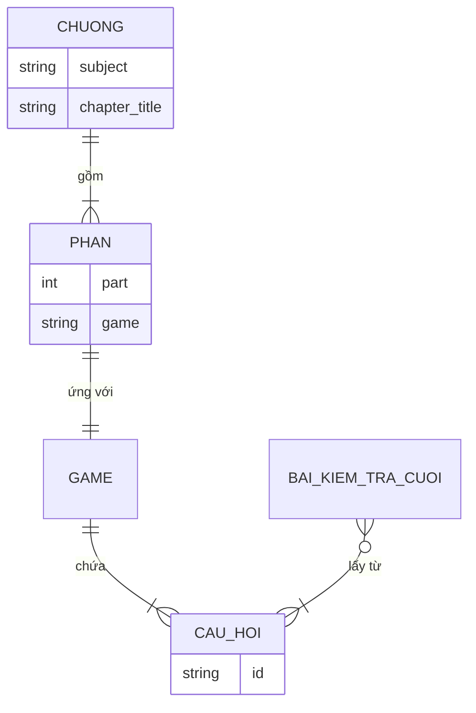

# 01. Kịch bản và Planning: Web ôn bài bằng các trò chơi

> File này là bản thiết kế chính thức của phần game, nằm trong `docs/`.
> Agent và các thành viên đọc file này trước khi code. Mọi thay đổi kế hoạch phải sửa file này và commit.
> Những chỗ ghi **[Cần chốt]** là điểm nhóm chưa thống nhất; chưa chốt thì không tự suy diễn.
> Danh sách việc cụ thể đang làm nằm ở `02-viec-can-lam.md`.

## 1. Tổng quan

| Mục | Nội dung |
|---|---|
| Tên dự án | Web ôn bài bằng các trò chơi |
| Đối tượng sử dụng | Người muốn ôn bài |
| Mục tiêu | Người học tải tài liệu lên, hệ thống biến thành các trò chơi ôn tập để việc ôn bài bớt khô khan |
| Phạm vi của tài liệu này | Phần game: từ lúc có `chapter.json` đến lúc hiện kết quả (3 game, server dẫn thứ tự, giao diện HTML). Phần tải file, tiền xử lý, AI sinh câu hỏi do thành viên khác phụ trách |
| Ngoài phạm vi | Đăng nhập, lưu lịch sử học lâu dài |

## 2. Tính năng

| Mã | Tính năng | Ghi chú |
|---|---|---|
| F1 | Tải file Word, PDF chứa nội dung muốn ôn | Thuộc module khác (tiền xử lý) |
| F2 | Chơi game 1: điền chỗ trống | Người học **gõ** đáp án |
| F3 | Chơi game 2: nối từ | Nối thuật ngữ với định nghĩa |
| F4 | Chơi game 3: trắc nghiệm | Chọn 1 trong 4 phương án |
| F5 | Làm bài kiểm tra cuối | Mở sau khi xong cả 3 game |
| F6 | Xem điểm | Điểm từng game và điểm bài kiểm tra cuối |
| F7 | Ôn lại các câu sai | Dùng danh sách câu sai trong kết quả |

## 3. Mối quan hệ giữa các thành phần

- Một **Chương** gồm nhiều **Phần**.
- Mỗi **Phần** ứng với một **Game**.
- Mỗi **Game** chứa nhiều **Câu hỏi**.
- **Bài kiểm tra cuối** lấy câu hỏi từ các Game đã chơi.
- File `.json` (`chapter.json`) là dữ liệu vào của Game.

## 4. Luồng xử lý

Mỗi dòng ghi rõ ai làm gì (dùng để vẽ sequence diagram):

1. Người học tải file Word/PDF của một chương (ví dụ: Chương 1, Triết học đại cương).
2. Module tiền xử lý trích văn bản; Module AI sinh câu hỏi và đáp án thành `chapter.json`.
3. Server đọc `chapter.json` và chuẩn bị 3 game.
4. **GameFlow** (thực hiện trong `server.py`) xác định thứ tự 3 game (giai đoạn 1: `fill_blank` → `matching` → `quiz`). **Không có màn hình chọn game.**
5. Giao diện hiện game đầu tiên; người học trả lời từng câu.
6. Game báo đúng/sai và trả kết quả khi xong; server mở game kế tiếp.
7. Khi xong cả 3 game, giao diện mở bài kiểm tra cuối.
8. Hệ thống chấm điểm và hiện kết quả cùng danh sách câu sai.

## 5. API với app (giao tiếp giữa các phần)

| Từ | Đến | Giao tiếp |
|---|---|---|
| Giao diện (`web/*.html`) | Server | `POST /api/<game>/new`, `/check`, `/result` (hiện có cho `matching`, `fill_blank`; cần thêm cho `quiz`) |
| Server | Game | tạo game từ `items`; gọi `check` / `check_one`; gọi `result()` |
| Game | Server/Giao diện | `public_view()` (không chứa đáp án); kết quả `{score, total, wrong}` |
| Module AI | Game | file `chapter.json` theo hợp đồng dữ liệu |
| GameFlow | Giao diện | trạng thái game nào đã xong / được mở |

## 6. Dữ liệu và quy tắc

**Dữ liệu vào:** file `chapter.json` có cấu trúc câu hỏi và đáp án (hợp đồng chi tiết nằm trong `CLAUDE.md`).

**Cấu trúc game:** mỗi game là một module gồm 3 phần: hiển thị dữ liệu, chấm, trả kết quả.

**Hành vi từng game (đã chốt):**
- Điền chỗ trống: gõ đáp án; so khớp không phân biệt hoa/thường, bỏ khoảng trắng thừa.
- Nối từ: nối thuật ngữ với định nghĩa; chấm theo `id`.
- Trắc nghiệm: chọn 1 trong 4 phương án; đáp án là chỉ số 0..3.

**Quy tắc chấm điểm (theo kế hoạch của nhóm):**
- Mỗi câu đúng được 5 điểm; câu sai không bị trừ.
- Tổng mỗi trò chơi là 100 điểm.
- Trong code, `score` hiện là **số câu đúng**. Điểm hiển thị = `score × 5` (nếu đủ 20 câu) hoặc `score / total × 100`. Giữ nguyên ý nghĩa của `score`, tính điểm ở lớp hiển thị.

**Hệ quả cần nhớ:**

| Quy tắc | Hệ quả |
|---|---|
| 5 điểm/câu, 100 điểm/game | Mỗi game cần đúng 20 câu. Dữ liệu mẫu hiện chỉ có vài câu mỗi game nên chưa đủ; chương ngắn có thể không sinh đủ 20 câu |
| Bài kiểm tra cuối: 50 câu, lấy từ các câu đã ôn | Nguồn có 3 × 20 = 60 câu, lấy 50 câu |

**Bài kiểm tra cuối:**
- 50 câu lấy từ các câu hỏi đã ôn.
- **[Cần chốt]** Cách chấm: đề xuất thang 100, mỗi câu 2 điểm (50 × 2 = 100).
- **[Cần chốt]** Cách chia 50 câu từ 3 game (ví dụ: 17–17–16, hoặc ngẫu nhiên có ràng buộc mỗi game ít nhất một số câu).
- **[Cần chốt]** Báo cáo của nhóm đang ghi bài kiểm tra cuối là 10 câu (3–3–4). Phải sửa một nơi cho khớp.

**Lựa chọn thay thế:** chấm theo tỷ lệ (điểm = số câu đúng / tổng số câu × 100) để chương có ít hơn 20 câu vẫn ra thang 100. **[Cần chốt]** nếu nhóm muốn thay quy tắc "5 điểm/câu".

## 7. Giai đoạn và phạm vi

| Giai đoạn | Nội dung | Điều kiện sang giai đoạn sau |
|---|---|---|
| 1 | Thứ tự game cố định để đảm bảo mọi game chạy | Cả 3 game và bài kiểm tra cuối chạy hết luồng, test pass |
| 2 | Random thứ tự 3 game | Đổi thứ tự không làm hỏng mở khóa và bài kiểm tra cuối |

Thiết kế để chuyển giai đoạn dễ: thứ tự game là một danh sách cấu hình (`GAME_ORDER`), việc mở khóa kiểm tra theo **vị trí trong danh sách**, không theo số `part` trong JSON.

## 8. Quyết định và việc còn mở

**Đã chốt:**

| # | Quyết định |
|---|---|
| A | Điền chỗ trống là **gõ đáp án**; logic chọn phương án thuộc về trắc nghiệm (`quiz.py`) |
| B | Phần game đi theo `server.py` + `web/`; chơi theo thứ tự cố định, bỏ màn hình chọn game |
| C | Quy tắc chấm: 5 điểm/câu, sai không trừ, 100 điểm/game |

**Còn mở:**

| # | Việc | Ai quyết | Trạng thái |
|---|---|---|---|
| 1 | Bài kiểm tra cuối: 10 hay 50 câu (báo cáo và Planning đang khác nhau) | Cả nhóm | Chưa chốt |
| 2 | Cách chấm bài kiểm tra cuối | Cả nhóm | Chưa chốt |
| 3 | Cách chia 50 câu từ 3 game | Người làm bài kiểm tra cuối | Chưa chốt |
| 4 | Giữ "5 điểm/câu cố định" hay chấm theo tỷ lệ | Cả nhóm | Chưa chốt |
| 5 | Báo cáo ghi Streamlit + Streamlit Cloud, còn phần game dùng `server.py`: thống nhất hướng và sửa báo cáo/nơi triển khai | Cả nhóm | Chưa chốt |
| 6 | `id` của câu hỏi: do hệ thống tự gán (đề xuất) | Người làm module AI | Chưa chốt |
| 7 | `quiz.py` là phần của Sơn Nguyễn theo báo cáo, nay giao cho phần game: báo cho Sơn Nguyễn | Hai người liên quan | Cần trao đổi |

## 9. Liên hệ với các sơ đồ

| Mục trong file này | Sơ đồ tương ứng |
|---|---|
| 2. Tính năng | Use case |
| 3. Mối quan hệ | Class diagram / ERD |
| 4. Luồng xử lý | Sequence diagram |
| 7. Giai đoạn | State diagram (trạng thái mở khóa) |

Các sơ đồ mẫu nằm trong `01-UML-phan-game.md`.
