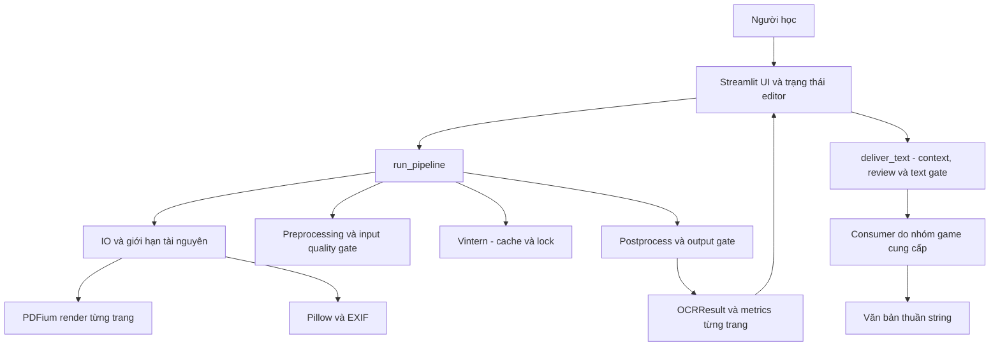
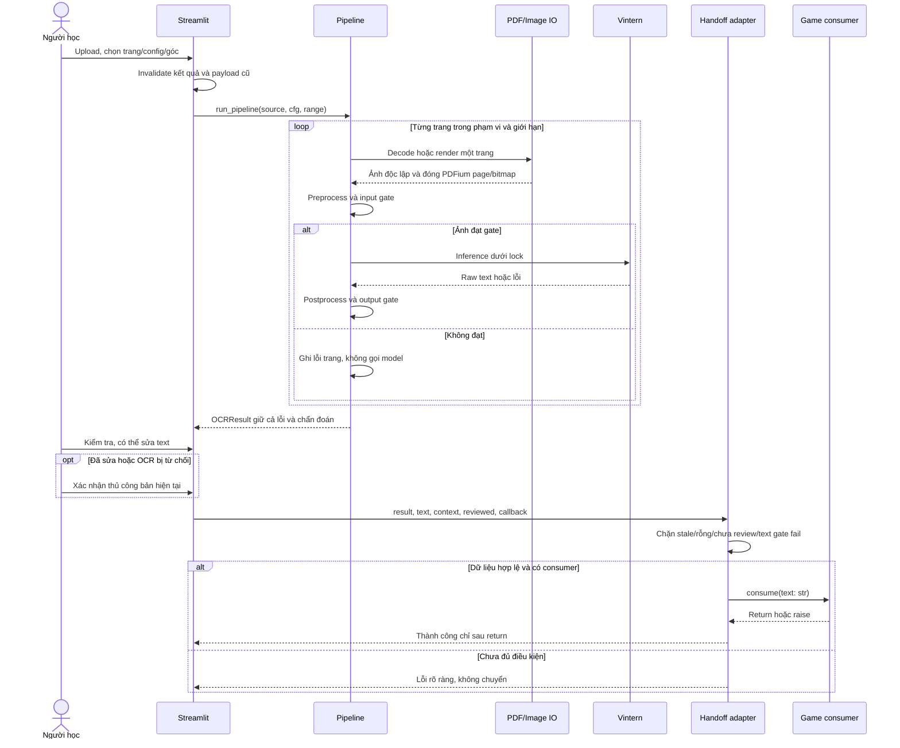
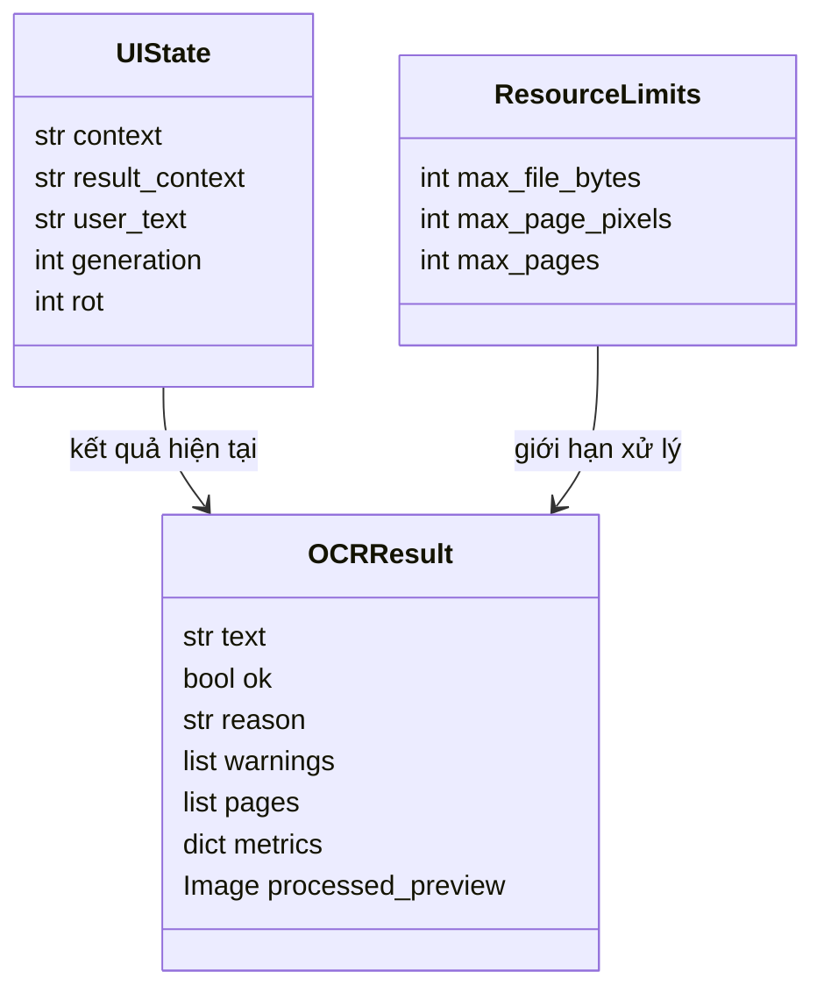

# Kiến trúc OCR và các quyết định

## Sơ đồ module

## Luồng OCR → Game

## Mô hình dữ liệu nội bộ

Không có bảng database trong phân hệ này nên không tạo ERD giả. Nhóm tổng thể chịu trách nhiệm ERD nếu có lưu tiến độ hoặc tài khoản.

## ADR

| Quyết định | Lý do và hệ quả |
|---|---|
| Giữ Streamlit và Python callback | Đủ cho phạm vi OCR cục bộ, consumer chỉ phụ thuộc str. Không thêm API server/framework/DB/Docker khi chưa có nhu cầu triển khai tương ứng. |
| Giữ bảy trường OCRResult | Tất cả consumer hiện có nằm trong pipeline, UI, CLI và eval; contract test giữ defaults. metrics bổ sung per_page, giữ khóa trang cuối cho caller cũ. |
| PDF iterator và resource guard | Giới hạn RAM raster; ảnh đầu vào vẫn render cùng scale. List API cũ vẫn tồn tại để tương thích. |
| Lock quanh cache và inference | Tránh nạp đôi model hoặc session thay cache khi session khác dùng. Đánh đổi: throughput cùng process bị tuần tự, chưa có benchmark nhiều người dùng. |
| Giữ nguyên ngưỡng/thuật toán OCR | Chưa có paired evaluation trên dữ liệu thật để chọn default khác. Perspective chưa triển khai sẽ báo lỗi khi bật. strip_target_lines là trường dự phòng, đổi khỏi 15 sẽ báo lỗi. |
| Dùng Mermaid cho sơ đồ | Tài liệu quy trình cho phép PlantUML; LuuY yêu cầu sửa bằng Mermaid. Chọn Mermaid để đáp ứng yêu cầu chấm cụ thể hơn. |

Rủi ro chưa giải quyết: mặc định resize 1600 có thể khiến strip threshold 2400 không được chạm tới; khử lặp có thể xóa nội dung lặp hợp lệ; threshold chưa hiệu chuẩn. Các điểm này cần dữ liệu có nhãn, không tự đổi thuật toán theo suy đoán.
